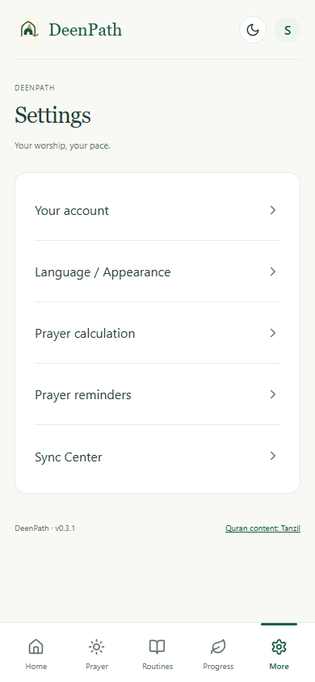
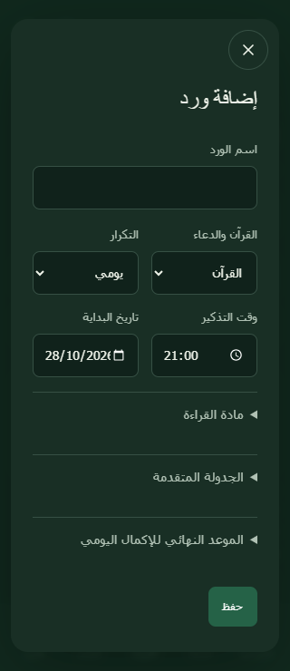

# Screen review — DeenPath v0.3.1

Captured on 28 October 2026 in isolated Chrome browser contexts. The before screens were freshly captured from the released v0.3.0 APK's web assets served locally; after screens were freshly captured from the revised production build. English comparisons use the same 390×844 viewport and light appearance. The Arabic close-control check uses 320×740 and dark appearance. These are browser previews, not screenshots from a connected Android phone.

1. **Home — improved.** The duplicate summary ring and garden preview crowded the daily overview. The revised screen keeps the next prayer, today's prayer rows and routines, with flexible cells and more room for status/action labels. At the matched width, page height changed from 1,703 to 1,464px; both pages measured 390px wide without whole-page horizontal overflow. The old direct Chrome CLI capture had a cropped viewport and was rejected; these accepted captures use explicit viewport emulation. Garden remains in Progress.

   [Before Home](before-01-home.png) · [After Home](after-01-home.png)

2. **Settings — improved.** The old page stacked account, language, location, prayer, sound and sync controls into a 3,994px screen. The new entry view is a five-row category menu in a single viewport; only the chosen category opens. Advanced settings remain available rather than being deleted.

   

   [Full before Settings](before-02-settings.png)

3. **Reminder controls — UI checked; Android delivery still needs a phone.** Test controls are near the start of the reminder category. Quiet hours, stage intervals and less common controls are expandable. The UI explains missing overlay permission and possible inexact background timing. Browser buttons are intentionally disabled because the preview has no Android bridge. The empty-native-snapshot bug and dispatcher test suppression were identified in code and covered by native snapshot regression tests; screenshots do not prove OS delivery or sound.

   [Reminder settings after](after-03-reminders.png)

4. **Routine dialog — improved; right-edge placement checked.** The old form exposed weekday, month-day, interval, target and Dhikr controls together. The revised daily Quran form shows the relevant fields, with reading material and advanced settings available on demand; Save is visible without scrolling through unrelated fields. The English before screenshot already placed the close button on the right, so a centered English close button was not reproduced in that preview. This patch explicitly pins the physical-right position in RTL as requested, uses an icon, reserves title space and checks a 44px target. The native overlay header is also explicitly ordered to keep its close control right.

   [Before routine dialog](before-04-dialog.png) · [After routine dialog](after-04-dialog.png)

   

## Checks and limits

Thirteen browser flows pass, covering existing counters, persistence, form typing, delete/toast dismissal, language/appearance, Qaza integrity, private recovery counters, learning/Guidance, calendar/Qibla fallback, category navigation, relevant routine fields, RTL close geometry and 320px badge/action overlap. Expanded private sections stay open during saves. These checks and visual inspection do not establish full accessibility compliance. Screen-reader behavior, actual Android text scaling/keyboard, native persistence, ringtone playback, notification arrival, overlays and manufacturer battery restrictions still need real-device qualification.
