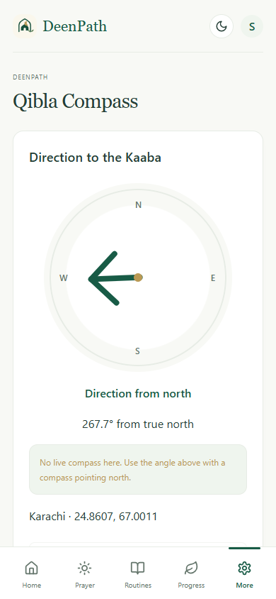
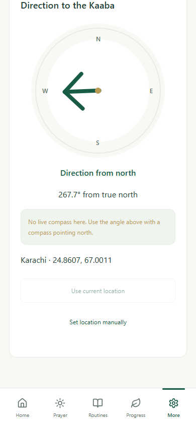
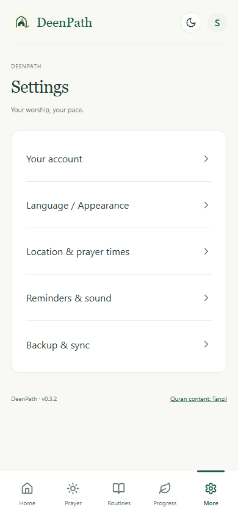
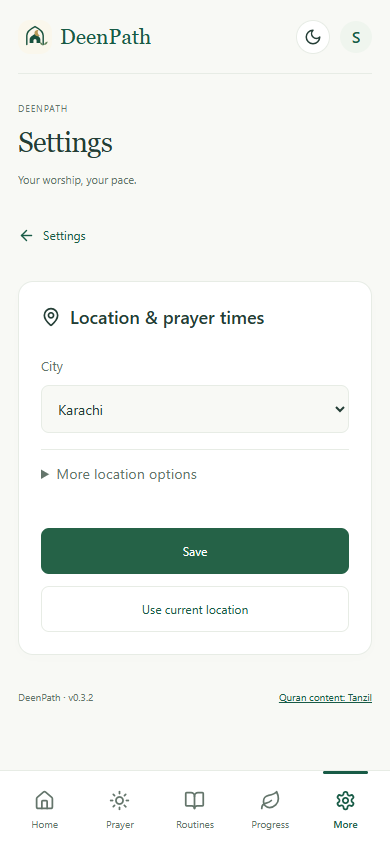
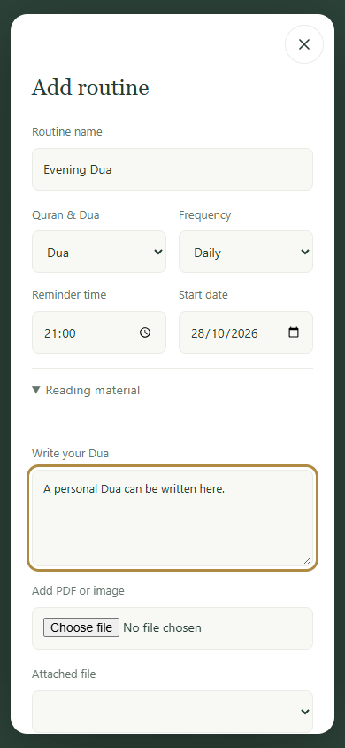
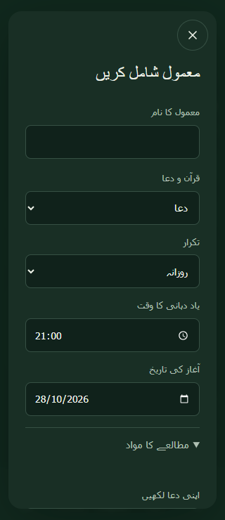
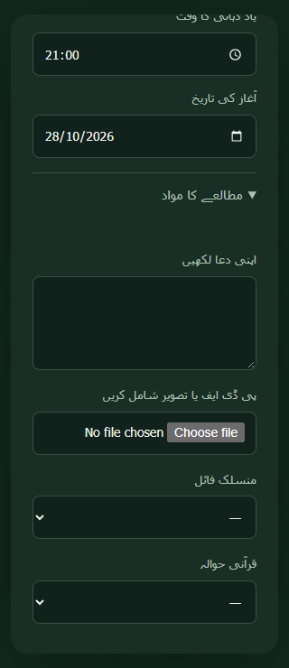
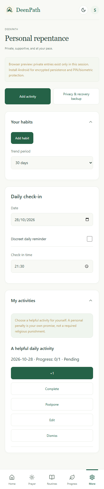
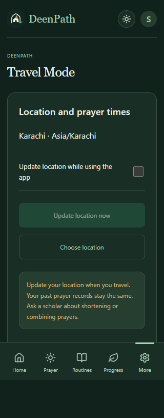

# v0.3.2 screen checks

Captured from the built app in Playwright at 390 × 844 (English/light) and 320 × 740 (dark, including Urdu). These are browser views of the app, not Android service screenshots.

1. **Qibla — improved; physical sensor unverified.** One direction arrow, a north dial, clear bearing and a plain no-sensor message. The controls are shown separately after scrolling. The native sensor still needs calibration and a real-phone comparison.

   
   

2. **Settings and location — checked.** The five-choice menu fits one phone screen. Location exposes the city and main actions first, with extra fields under More location options. Back returns to the list before Home.

   
   

3. **Dua editor — checked.** The reading section opens by default and includes text, a new-file upload and a saved-file selector. The browser regression saves text and a PDF attachment, reloads, reads the text, and verifies both values in the editor. It does not test Android PDF rendering. Narrow date fields use one column to avoid clipping.

   
   
   

4. **Personal repentance — checked in preview.** Add activity is visible at the top. Saving opens the activity list, and a new activity can be completed without a habit or slip. Private preview entries remain session-only; Android encrypted persistence is outside this browser check. The existing habit-to-penalty flow also passes its regression.

   

5. **Travel — checked.** At 320px, the action buttons stack with a gap, and the explanation sits below them. Choose location opens the relevant settings category directly.

   

Keyboard Back-event tests cover modal closing, settings categories and prayer detail pages. There is no horizontal page overflow in the tested small layouts. These checks are not a complete accessibility certification. Hardware Back, compass readings, screen overlays, notification audio and delivery after process death require a phone; see [release test steps](../V0.3.2-FIXES.md).
